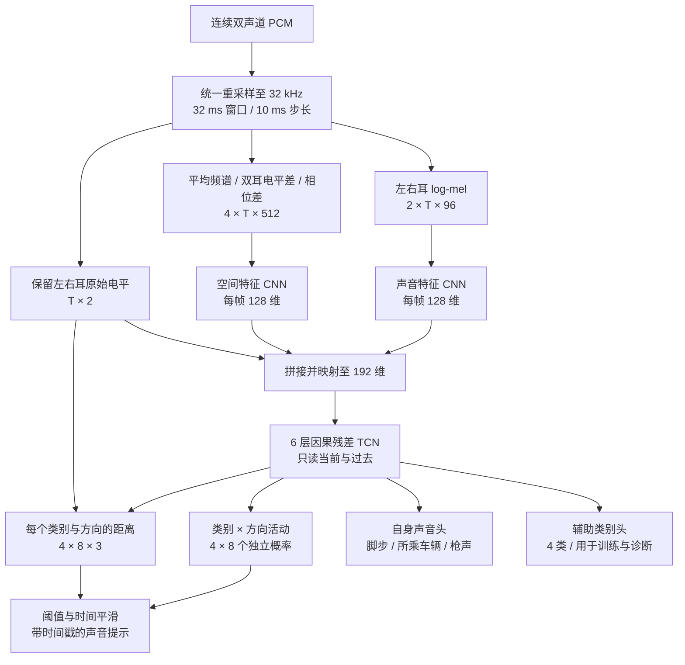

# PUBG 双声道声音分类与定位：第一版网络设计

2026-09-06。状态：用户已接受作为首轮原型路线。三类合成数据已生成并验证，网络尚未训练，也没有模型识别率或运行延迟的实测结果。最新数据现状见[远处与自身声音 v3](C:/Projects/PUBGAssistant-cpp/docs/audio/远处与自身声音_v3.md)。

建议采用**双分支轻量 CNN + 因果 TCN + 类别与方向联合输出**。CNN 从短时间频谱中提取声音特征，TCN 利用过去约 1.37 秒的变化识别脚步节奏、枪声连发和持续发动机声；输出外部声源每个类别在八个方向上的活动概率，再为活动项给出近、中、远；另设三维自身声音输出。

这里的通道数、层数、时间窗和损失权重是本项目的初始设计选择，需要通过实验筛选。论文支持相关方法的可行性，不代表本项目已经达到论文效果。

**任务及当前数据基础**

| 项目 | 第一版约定 |
| --- | --- |
| 类别 | 脚步、车船、枪声、运输飞机，共 4 类 |
| 方位 | 前、右前、右、右后、后、左后、左、左前；顺时针 0°—315°，间隔 45° |
| 距离 | 近、中、远的听感分档；沿用已接受的生成基准，不换算精确米数 |
| 多声音 | 允许不同类别同时出现，也允许同类在不同方向同时出现 |
| 时间 | 连续音频逐帧检测，而不是每个 6 秒文件只给一个标签 |
| 自身声音 | 独立识别自身脚步、所乘车辆和自身枪声；可与外部同类同时出现 |
| 暂不输出 | 高度、精确坐标、外部声源敌我身份、人数；一个方向的脚步不等于一个人 |

已验收的 15 段证明当前生成方法可以作为试听和原型数据基准。它们只覆盖前三类，其中 S08 已由原始 bank/media 核验为 Buggy 怠速。四类训练前还需要补运输飞机、背景/易混淆声音及更多独立素材。15 段保留为回归试听锚点；它们参与过方案选择，不能单独充当泛化效果的证据。

**查到的代表性网络与论文**

| 研究 | 大致网络结构 | 对我们的用途与限制 |
| --- | --- | --- |
| [PANNs，IEEE/ACM TASLP 2020](https://arxiv.org/abs/1912.10211) | log-mel 频谱 → 多层 2D CNN → 全局池化 → 全连接分类。CNN14 有 6 个双卷积块，通道依次为 64/128/256/512/1024/2048 | 说明音频分类可以像识别图像一样学习频谱纹理，预训练可迁移。整段时间池化不能直接保留每个事件的发生时间与方向 |
| [AST，Interspeech 2021](https://arxiv.org/abs/2104.01778) | 频谱切成 16×16 patch → 位置编码 → 12 层 Transformer → 分类 token | 能建模较长范围的联系，可作分类对照；原结构不提供双耳定位，也不是本项目首选的实时小模型 |
| [EfficientAT，ICASSP 2023](https://arxiv.org/abs/2211.04772) | MobileNetV3 倒残差/深度卷积 → 池化分类；训练时由 Transformer 教师蒸馏 | 参考其降低卷积成本的方法。论文默认 MN 模型约 4.88M 参数；作者也提供更小型号。本设计拓扑不同，不能直接加载其完整权重。[作者代码](https://github.com/fschmid56/EfficientAT) |
| [SELDnet，2018 预印本／2019 期刊论文](https://arxiv.org/abs/1807.00129) | 多通道幅度与相位 → CNN → 双向 GRU → 事件活动及对应方向 | 与目标最接近的任务框架：事件检测与定位联合学习。原版每类一个方向，不足以表示同类多方向；双向 GRU 也需要后续音频 |
| [SELD-TCN，EUSIPCO 2020](https://arxiv.org/abs/2003.01609) | CNN → 膨胀时间卷积残差块 → 类别/方向输出 | 支持用 TCN 替换循环网络。但论文实际采用非因果卷积来利用未来信息；我们改成只在时间左侧补齐的因果结构 |
| [Sound Event Detection and Localization with Distance Estimation，EUSIPCO 2024](https://arxiv.org/abs/2403.11827) | 双耳或 Ambisonics 特征 → CNN → 双向 GRU/注意力 → 类别、方向、距离 | 最直接的参考：论文确实做了双耳实验，双耳输入包含平均幅度、ILD、sin/cos IPD，并比较独立距离分支与 multi-ACCDDOA。我们把距离简化成三档 |

还有两项补充参考：

- [CRNN on Pairs of Microphones，2019](https://arxiv.org/abs/1910.10049)：将互谱及 GCC-PHAT 分支结合。不过论文的完整定位系统使用四麦克风的六对结果，不能把它的三维定位结果当成仅一对左右耳的保证。
- [BiSELD，KAIST 2024 博士论文，2025 上传 arXiv](https://arxiv.org/abs/2508.04333)：专门研究双耳 HRTF、前后混淆和频谱线索，可支持后续特征消融。本次只核对了摘要及文献信息，未完整审阅其 200 页正文，因此不以它的性能主张作为选型依据。

论文里的 AudioSet 分类成绩和 DCASE 定位成绩属于不同数据、通道格式及指标，不能横向当作本项目的预计正确率。

**整体结构**

两路输入保留的是互补信息。“声音特征”分支学习枪响的短促宽频成分、脚步的冲击和衰减、发动机的持续频谱；“空间特征”分支利用左右差异，以及与 HRTF 相关的频谱形状。两路融合后共同预测，避免先猜一个全局方向再把所有类别都贴上去。

左右音量差和时间差对左右判断有帮助，但正前与正后都可能几乎没有左右差异。应保留高频频谱形状及频率位置，单靠音量差或一个互相关峰不能可靠解决前后问题。该选择参考双耳研究；能否适配实际游戏混音仍需验证。[双耳输入与特征说明](https://arxiv.org/html/2403.11827v1)

**输入特征的确定方式**

原始试听 WAV 仍保持 44.1 kHz。仅模型输入统一为 32 kHz，给定位分支保留到 16 kHz 的频率内容；这比直接降至 16 kHz 音频保留更多高频线索，但不是已证明的最优采样率。后续用 44.1 kHz 作一次前后方向的对照实验。

前端使用 1024 点 periodic Hann 窗、320 点步长、`center=false`；每帧的时间戳位于窗口右端。设备如果输出 48 kHz，两个声道通过相同滤波器、相同状态时基重采样，滤波器延迟计入时间戳；不能分别异步重采样。

记左右 STFT 为 `X_L、X_R`，FFT 先除以窗函数之和，`P_L=|X_L|²、P_R=|X_R|²`，`eps=1e-10`：

| 输入 | 定义 |
| --- | --- |
| 左右 log-mel，2 通道 | 分别计算 `10 log10(M P + eps)`；HTK mel，96 带，50—15000 Hz，每个离散三角滤波器权重和为 1 |
| 平均频谱，1 通道 | `10 log10((P_L + P_R)/2 + eps)`；保留 FFT 第 1—512 格，不使用 DC |
| ILD，1 通道 | `clip(10 log10((P_L+eps)/(P_R+eps)), -30, 30)/30` |
| 相位差，2 通道 | `Z = X_L conj(X_R)`，输入 `Re(Z)/|Z|` 与 `Im(Z)/|Z|`；任一耳该格功率不超过 eps 时，两项均置零；实现分母仍须夹至正 epsilon，避免先产生 NaN |
| 电平旁路，2 维 | 每个未加窗分析片段的左右 `10 log10(mean(x²)+eps)/100`，供融合及距离头使用 |

log-mel 的标准化参数只从训练划分统计，左右耳使用同一组逐带均值与标准差。空间平均频谱也使用训练划分的固定逐频率统计；ILD、相位差及电平旁路按上表固定缩放。统计的标准差下限需防除零，随模型保存，推理时冻结。

不能在每段音频内或每个声道内单独拉齐响度。距离目前主要由增益和低通模拟，这种归一化会抹去已验收的线索。相位分支直接保留线性频率格，不对角度作算术平均，也不把麦克风阵列的 FOA 强度向量套到双耳输入上。

**逐层规格**

`B` 为批大小，`T` 为帧数；表中 CNN 输出省略 B。卷积核及步长均按“时间 × 频率”。CNN 只压缩频率，不压缩时间。每次时间核为 3 的卷积只补左侧 2 帧，频率两侧对称补齐。卷积无 bias，随后 BatchNorm 和 ReLU；部署使用冻结统计。

| 分支/层 | 运算 | 输出 |
| --- | --- | --- |
| 声音 stem | 普通卷积 2→24，3×3，步长 1×2 | 24 × T × 48 |
| 声音 DS1 | 深度卷积 3×3，步长 1×2；1×1 卷积 24→48 | 48 × T × 24 |
| 声音 DS2 | 深度卷积 3×3，步长 1×2；1×1 卷积 48→96 | 96 × T × 12 |
| 声音 DS3 | 深度卷积 3×3，步长 1×2；1×1 卷积 96→128 | 128 × T × 6 |
| 声音投影 | 每帧按频率顺序展平 768 维，Linear 768→128，ReLU | T × 128 |
| 空间 stem | 普通卷积 4→16，3×5，步长 1×4 | 16 × T × 128 |
| 空间 DS1 | 深度卷积 3×5，步长 1×4；1×1 卷积 16→32 | 32 × T × 32 |
| 空间 DS2 | 深度卷积 3×3，步长 1×2；1×1 卷积 32→64 | 64 × T × 16 |
| 空间 DS3 | 深度卷积 3×3，步长 1×2；1×1 卷积 64→96 | 96 × T × 8 |
| 空间投影 | 每帧按频率顺序展平 768 维，Linear 768→128，ReLU | T × 128 |
| 融合 | 两路特征及电平拼接，Linear 258→192，ReLU | T × 192 |
| 时间模块 | 6 个残差 TCN 块，膨胀率 1/2/4/8/16/32 | T × 192 |
| 活动头 | Linear 192→128→32，隐层 ReLU，末层独立 sigmoid | T × 4 × 8 |
| 距离头 | 拼接原始电平，Linear 194→128→96，隐层 ReLU，仅距离轴 softmax | T × 4 × 8 × 3 |
| 辅助类别头 | Linear 192→4，独立 sigmoid；外部与自身并集 | T × 4 |
| 自身声音头 | Linear 192→3，独立 sigmoid | T × 3 |

每个 TCN 块为 `因果深度卷积 k=3 → 1×1 扩展 192→384 → 1×1 投影 384→192 → 残差相加`。三个卷积后各有 BatchNorm；前两个卷积后加 ReLU，最后投影后 Dropout 0.1，再残差相加/ReLU。推理时关闭 Dropout，冻结 BatchNorm；流式一致性检查必须在 eval 模式进行。

与直接全频率平均不同，投影前保留频率位置，使不同频段的凹陷/能量分布仍能影响定位。没有整段时间平均、双向 GRU 或跨未来的注意力。

**输出如何表达多个声音**

活动矩阵里的每个格子都是独立概率，例如可以同时激活“左前脚步”“右侧枪声”“后方车船”。同类在不同方向也能同时激活，因此 32 个输出不使用全局 softmax。距离分支为每个格子单独预测三档分布，只有对应活动足够可信时才使用。

某类外部声音是否出现，由活动格子解码得到；自身声音由独立自身头给出。辅助类别头学习两者的并集，用于训练和诊断，不以一个辅助分类结果覆盖已关联好的方向输出。真正无目标的训练帧将外部及自身活动均标为0，不增加一个与其他声音互斥的“背景”类别。

这一版的明确上限是：**同类、同一 45° 扇区内的两个声源合并为一个活动提示**。若它们的距离标签不同，该格子的距离训练损失屏蔽，不能擅自取最近或平均距离；推理遇到这类混合时距离可能不可靠。需要把同格多个实例分别输出时，再升级为带排列不变训练的多轨输出。该升级有 multi-ACCDDOA 作为参考，首版暂不增加实例匹配复杂度。[多实例与距离输出参考](https://arxiv.org/abs/2403.11827)

未达到活动阈值时不输出提示；方向摇摆时可以暂不更新方向，距离分布不集中时显示“距离不确定”。这些是待验证的置信度与平滑策略，不能宣称已经具备可靠的未知声音识别能力。

**自身声音监督（v3 补充）**

自身声源绑定听者，使用独立的三维 sigmoid 输出，可同时检测“自身脚步”和“远处脚步”。外部方向头及距离头只监督外部源；自身在轨迹标签中距离为0、方位有效mask为0、扇区与距离档为-1。0是听者相对位置，不是测得的声学距离。

不得使用“预测为近→判成自己→删除”的规则。贴近玩家的外部脚步、枪声和车辆仍必须作为外部正例；自身概率也不能一票否决外部同类输出。`self_activity` 不是敌我分类，外部队友仍属于外部声源。

自身枪声优先使用客户端 Local，车辆启停使用 FPP。脚步的自身声场和连续发动机仍为合成近似，模型可能记住居中渲染特征；真正能否区分自身与贴近外部，需要独立真实游戏片段验证。评估增加自身误报/漏报、贴近外部被误归自身的比例、以及自身干扰下远处外部的召回率。当前没有训练结果。

**计算量、时间范围及实时接口**

下列数值由逐层规格进行解析核算，包含卷积/全连接权重、bias 和 BatchNorm 可训练参数；不是 PyTorch 前向测试或硬件测速。

| 项目 | 核算结果 |
| --- | --- |
| 可训练参数 | 1,243,855，约 124 万 |
| FP32 可训练权重体积 | 4,975,420 字节，约 4.98 MB；不含运行库、激活和 BN 运行统计 |
| 卷积/全连接 MAC | 每帧 1,632,512；按 100 帧/秒约 0.163 GMAC/秒 |
| 每次推理新增 4 帧 | 6,530,048 MAC；依赖正确复用历史状态 |
| CNN + TCN 历史状态 | 43,776 个 float32，175,104 字节；不含前端状态和临时激活 |
| 特征感受野 | 135 帧，其中过去 134 帧 |
| 覆盖音频时长 | `32 + (8 + 2×(1+2+4+8+16+32))×10 = 1372 ms` |

MAC 不含重采样、FFT、mel 投影、归一化/激活、内存搬运与后处理。参数少不等于已达到某个运行耗时，实际还要看推理后端及与游戏同时运行的负载。

模型每 40 ms 接收 4 个新特征帧，返回这 4 帧各自的活动与距离。每个 CNN 层缓存过去输入，TCN 每层缓存 `2×d` 帧输入，不反复计算整个 1.37 秒窗口。设备/采样率改变或录音断流时清理状态；捕获线程与推理线程通过有界缓冲交接，不能无限积累过期音频。

**1.372 秒是历史感受野，不是必须等待的推理延迟。** 首个分析窗需要 32 ms 音频，冷启动补过去的零并标记预热；持续运行时没有神经网络未来帧等待，但还有重采样延迟、最多一个调度周期的等待、推理耗时及提示平滑。第一次提示能多快、稳定方向需要多久，要分别测量。不能把 40 ms 的调用周期写成端到端响应时间。

**训练设计**

训练沿用已验收的“源参考增益 → 距离增益/低通 → HRIR → 公共主增益”顺序，原 15 段及其参数保持作为固定锚点。批量版本另建可复现的 recipe/seed，不用新的增强去回写旧样本。

1. 先整理独立源素材家族，再按 80%/10%/10% 分训练、验证、测试。来自同一录音、重复媒体 ID、相同底层素材的远近/左右版本及其增强必须在同一组；仅换随机种子不能形成独立测试。每个集合需覆盖四类，若飞机等类别素材过少，先报告覆盖不足，不能靠重切同一素材补出独立测试。
2. 数据规模沿用论文量级，最新 v3 为2400个30秒训练场景（20小时），验证和测试各300段（2.5小时）。外部初始近/中/远为10/10/80%；自身单独标注，不能计入外部近距离配额。低/中/高密度40/35/25%。旧版历史：曾生成 12,000 个 6 秒训练场景：低密度 4,800、中密度 4,200、高密度 3,000，另有验证/测试各 1,500 段。低密度允许偶发单源和长空白，高密度提高事件频率与重叠；远距离约占 65% 声源轨迹。旧版实际 WAV、标签及 recipe 均已保存，取代最初的 4,000 单源/6,000 混合/2,000 背景预算；当前系统性环境背景库仍待补充。
3. 各类别分别交叉覆盖 8 方位 × 3 距离，平衡材质/车型/枪型；脚步和连发节奏加入变化，避免学会当前 15 段固定节奏。先用现有方位中心训练通路，再加入扇区内位置，并保存实际使用的 HRIR 角度；标签按实际渲染角度分箱，检验 0°/360° 环绕及扇区边界。
4. 每个声源保存 `source_group_id、class、onset、offset、azimuth、range、gain、HRIR、seed` 及独立轨迹。事件标签覆盖实际可听区间，包含合理衰减尾声；不能把整段 6 秒都标成有枪声，也不能只标最初的一个采样点。被完全静音/遮蔽的源不应硬性要求检出。
5. 混合发生在双声道波形层，之后重新计算幅度、相位和标签。普通分类的 log-mel Mixup 不能直接作为定位样本混合，因为混合后的相位差不是两个相位图的线性平均。左右交换增强必须同步将角度变为 `(360°−θ) mod 360°`；其余时间/频率变换要保持两个声道一致。
6. 加入 Buggy 怠速与运输飞机的对照，以及语音、风雨、爆炸、门声、界面提示等背景/易混淆负例。运输飞机保持独立类别；必要时还需明确其他航空器的归类。最终声音提示本身如果会回录，也需避免形成误触发循环。
7. 首轮使用固定接受参数验证训练通路；下一轮加入公共响度、源强及小幅频谱变化，检查模型是否只记住三个低通截止频率。增强范围先保持三档有可分性。低通/响度随机化、遮挡及混响不可无限增大后仍假定远近标签总可辨。

初始损失：

`L = L_activity + 0.2 × L_range + 0.2 × L_class_aux + 0.5 × L_self`

`L_activity` 为 32 格带正例权重的二元交叉熵；权重只由训练数据计算并暂设上限 20。`L_range` 是活动且距离标签无冲突的格子上的三分类交叉熵；没有有效格子时该项为 0。辅助类别标签取 `any_class_activity`，是外部与自身的并集；应用其对应 mask。`L_self` 为自身三类独立 BCE，应用 `self_activity_loss_mask`，正例权重只从训练集统计并封顶20。每项按自己的有效元素数平均，避免 96 个距离输出在数量上压过检测目标。0.2 的距离权重体现距离次要，但该数值仍需用验证集选择。

训练可从这个小模型的随机初始化开始。若分类分支出现明显过拟合，再加入 EfficientAT 预训练分类对照或离线教师蒸馏；教师需要先适配本项目四类，不能直接把 AudioSet 类别或高置信输出当成游戏真值，也不能从单声道教师得到方向监督。

**验证和后续实现顺序**

| 检查 | 用途 |
| --- | --- |
| 特征与标签一致性 | 左右交换后的 ILD/IPD 符号、0°/360° 分箱、静音无 NaN、裁剪后起止标签同步 |
| 严格流式一致性 | eval 下整段因果前向与任意分块/状态缓存输出对齐；改变未来音频不能改变已有输出 |
| 模型导出一致性 | 实现后逐项对齐训练框架与 ONNX 输出，检查状态复位；当前未做导出 |
| 检测性能 | 各类 precision/recall、macro F1/PR 曲线、无目标片段每分钟误报数 |
| 方向性能 | 8 方向混淆矩阵、前后颠倒率、相邻方向误差；联合类别-方向 F1，不能只统计检出的简单样本 |
| 距离性能 | 近中远混淆矩阵、近↔远严重混淆率；与检测/方向指标分开报告 |
| 多源性能 | 按单源、异类重叠、同类不同方向、同类同扇区分组；不把折叠格子当实例分离成功 |
| 游戏小样本验证 | 少量未参与参数调整的立体声游戏片段检查误报、飞机/发动机混淆、前后反向、远近崩溃；不要求先完成大规模实测标注 |
| 运行时性能 | batch=1、实际 40 ms 调用，测 p50/p95 推理耗时、积压、冷启动和事件到提示延迟，随后在游戏负载下复测 |

优先级是**少误报、类别和粗方向正确，其次远近**。用户现在的验收意见不包含数字正确率门槛，暂不代设“已通过 90%”之类结论。阈值只在验证集确定，最后在固定测试集合上报告一次结果。

建议的首轮消融保持相同数据划分：只有声音分支 → 加空间分支 → 加时间模块，分别观察方向/类别变化；距离权重 0 与 0.2 比较是否拖累检测。若前后仍弱，对比 32/44.1 kHz 与空间频率压缩率；若飞机/车船混淆集中在持续声，可增加膨胀率 64 的第七个 TCN 块，将历史音频范围扩至 2.652 秒，再判断收益。

实施顺序为：先完成特征提取、标注转换和上述网络的训练代码；补齐四类素材后跑单源验证，再加入混合和背景；最后导出 ONNX，测真实片段与运行成本，确定实时提示策略。现阶段已把第一版结构设计具体化，无需等待精确米数标定。

**本次交付与复核范围**

- [机器可读层级规格](C:/Projects/PUBGAssistant-cpp/docs/audio/model_v1.json)：输入、逐层参数、输出、损失及数据约定。
- [逐层参数与运算量核算](C:/Projects/PUBGAssistant-cpp/docs/audio/model_v1_audit.json)：每层输出形状、参数及 MAC。
- [核算脚本](C:/Projects/PUBGAssistant-cpp/docs/audio/audit_model_spec.py)：只用 Python 标准库，可重新生成核算结果。

目前完成的是设计与解析核算；训练代码、权重、识别效果、ONNX 和实时集成均待后续实现。
